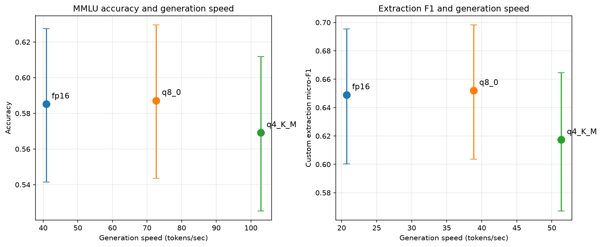

# Quantization Effects on LLM Output Quality

**A controlled paired study of Llama 3.1 8B Instruct: FP16 vs Q8_0 vs Q4_K_M**

Kristen Martino · [kristenmartino.ai](https://kristenmartino.ai) · [Repo](https://github.com/kristenmartino/llm-quantization-study)

[](https://github.com/kristenmartino/llm-quantization-study/actions/workflows/test.yml)

---

## TL;DR

Scope: Llama 3.1 8B Instruct, two English tasks, fixed decoding settings (temperature 0, seed 42), local Ollama on Apple Silicon/Metal. See [Limitations](#limitations).

**Q8_0 met the study’s ±1 percentage-point equivalence criterion on both tested tasks.** The reported TOST p-values were 0.019 for MMLU accuracy and 0.002 for sentence-average extraction F1. For the custom extraction micro-F1 score, the 95% confidence interval for FP16 minus Q8_0 was −0.9 to +0.2 percentage points, also within that margin.

Q8_0 generated tokens about 1.8× faster than FP16 and had roughly half the model footprint on this setup.

**Q4_K_M scored lower than FP16 on both extraction measures.** The custom corpus micro-F1 dropped by 3.2 percentage points (95% CI: 0.7–5.7; Holm-adjusted p = 0.032). Sentence-average F1 dropped by 5.0 percentage points (95% CI: 2.1–8.1; Holm-adjusted p = 0.003).

Q4_K_M generated tokens about 40% faster than Q8_0. Its model footprint was about 4.9 GB, compared with FP16’s 16 GB. MMLU accuracy was 1.6 percentage points below FP16; that difference was not statistically significant.

## Study question

How do FP16, Q8_0 and Q4_K_M versions of Llama 3.1 8B Instruct compare on knowledge questions and named-entity extraction? The experiment uses the same test items, prompts and run settings across versions and compares output quality, token-generation speed and model footprint.

---

## Method

**Treatment.** Quantization level — three arms: FP16 (control), Q8_0, Q4_K_M. All three pulled from Ollama: `llama3.1:8b-instruct-{fp16|q8_0|q4_K_M}`.

**Tasks.**
- **MMLU** — four-option knowledge questions sampled across 10 subjects. Each model processes 500 sampled rows; the analysis uses 499 paired question IDs after collapsing one repeated ID. The scorer reads the first A–D character in each response and compares it with the recorded answer.
- **Named entity recognition (CoNLL-2003).** Entity extraction on 300 test sentences. The model returns entity text and types in a JSON array. The scorer lowercases entity text and compares unique text/type pairs, collapsing repeated identical mentions within each sentence.

  Results include custom corpus micro-F1 from pooled match counts and sentence-average F1. This scoring method does not preserve mention positions and is not standard CoNLL evaluation. The parser accepts `text|entity|span` and `type|label|tag` aliases. Malformed JSON contributes annotated entities as false negatives to the pooled counts and receives a sentence score of zero.

**Design.** Each test item is processed by all three model versions before moving to the next. Models are warmed up before timing begins. Alternating between versions is intended to limit timing differences caused by hardware temperature and background system activity.

**Sampling.** Temperature = 0, fixed seed (42), identical prompts and system messages, max_tokens task-appropriate. Held constant across arms.

**Statistics.**
- **MMLU.** Per-model accuracy uses Wilson 95% confidence intervals. Pairwise confidence intervals and equivalence tests use a paired bootstrap that resamples subject groups. McNemar’s test supplies p-values for differences in accuracy.
- **Entity extraction.** Confidence intervals for custom corpus micro-F1 resample sentences and pool their match counts. Pairwise comparisons resample the same sentences for both model versions, recalculate each version’s F1, and take the difference. Sentence-average F1 comparisons use paired sentence scores. Two-sided bootstrap p-values use distributions centered on a zero difference.
- **Multiple-comparison correction.** Holm’s method adjusts p-values separately for MMLU accuracy, extraction corpus micro-F1 and sentence-average F1. Each group contains the three pairwise comparisons among FP16, Q8_0 and Q4_K_M.
- **Equivalence testing.** The analysis uses two one-sided tests (TOST) with a ±1 percentage-point margin for accuracy and sentence-average F1. Equivalence is declared when the paired 90% confidence interval lies entirely inside that margin. The margin was selected for the equivalence reanalysis.

**Approximate sensitivity.** For FP16 versus Q4_K_M, a post-hoc normal approximation estimates 80% power to detect differences of about 3.8 percentage points in MMLU accuracy (499 paired questions) and 4.3 points in sentence-average extraction F1 (300 paired sentences), at a 5% significance threshold.

These estimates use the observed paired-score variability. They do not incorporate subject-level resampling or multiple-comparison correction.

**MMLU sample count.** Each saved output file contains 500 rows and 499 distinct example IDs. Two `high_school_mathematics` rows share the same question-based ID. The analysis retains the last record for each ID, leaving 499 aligned pairs.

The current task loader includes the source row index in each ID and records a separate content hash. That ID scheme applies to new runs; the reported results use the original saved outputs.

**Provenance.** `results/experiment_manifest.json` records each version’s weight-file hash and model configuration, plus the Ollama version, host, seed, sampling settings and dataset IDs. The recorded chat templates and stop tokens match across versions. These records document artifact identities and configurations; they do not prove identical base weights and tokenizers or establish that quantization was the only difference.

**Hardware.** MacBook Pro (Apple M4 Max, 14-core CPU / 32-core GPU, 36 GB unified memory), Ollama 0.22.1, llama.cpp Metal backend.

---

## Results

### Headline numbers

| Arm     | MMLU accuracy [95% CI] | Custom extraction micro-F1 [95% CI] | Sentence-average extraction F1 | NER precision / recall | Generation tokens/sec (MMLU / extraction) | Model footprint¹ |
|---------|-------------------------|------------------------------------|------------------------------|------------------------|----------------------|----------|
| FP16    | 0.585 [0.541, 0.628]    | 0.649 [0.600, 0.696]               | 0.614 [0.570, 0.662]         | 0.553 / 0.785          | 40.9 / 20.7          | ~16.0 GB |
| Q8_0    | 0.587 [0.544, 0.630]    | 0.652 [0.604, 0.698]               | 0.614 [0.568, 0.661]         | 0.557 / 0.785          | 72.7 / 38.8          | ~8.5 GB  |
| Q4_K_M  | 0.569 [0.525, 0.612]    | 0.617 [0.567, 0.665]               | 0.564 [0.518, 0.611]         | 0.512 / 0.776          | 102.9 / 51.3         | ~4.9 GB  |

The extraction metrics use the study’s custom text/type-pair scorer. Corpus micro-F1 and precision/recall pool match counts; sentence-average F1 averages sentence scores.

¹ Model footprint as reported by Ollama (`ollama show`). This excludes runtime overhead such as the KV cache and activations and should not be read as peak memory usage. The test machine uses unified memory.

### Pairwise differences (95% confidence intervals; Holm-adjusted per metric)

| Comparison | Δ MMLU accuracy [95% CI; adjusted p] | Δ custom extraction micro-F1 [95% CI; adjusted p] | Δ sentence-average extraction F1 [95% CI; adjusted p] |
|-------------------|--------------------------------------|---------------------------------------------|---------------------------------------------|
| FP16 − Q8_0       | −0.002 [−0.008, +0.004]; p_adj=1.00  | −0.003 [−0.009, +0.002]; p_adj=0.29         | +0.000 [−0.006, +0.007]; p_adj=0.92         |
| FP16 − Q4_K_M     | +0.016 [−0.006, +0.036]; p_adj=0.70  | **+0.032 [+0.007, +0.057]; p_adj=0.032***   | **+0.050 [+0.021, +0.081]; p_adj=0.003***   |
| Q8_0 − Q4_K_M     | +0.018 [−0.002, +0.038]; p_adj=0.70  | **+0.035 [+0.009, +0.060]; p_adj=0.030***   | **+0.050 [+0.020, +0.081]; p_adj=0.003***   |

Differences are the first version minus the second, in score units; 0.01 equals one percentage point.

Significance markers (`*`) indicate Holm-adjusted p-values below 0.05 within each metric’s three-comparison group. Q4_K_M scored significantly lower than both FP16 and Q8_0 on custom corpus micro-F1 and sentence-average F1. None of the MMLU comparisons was statistically significant after correction. The following table assesses FP16 and Q8_0 equivalence using the study’s ±1 percentage-point margin.

### Equivalence: Q8_0 vs FP16 (TOST, ±1pp practical-equivalence margin)

| Metric | Δ (FP16 − Q8_0) | Confidence interval | TOST p-value | Result |
|---|---|---|---|---|
| MMLU accuracy | −0.002 | 90%: [−0.008, +0.004] | 0.019 | equivalent |
| Sentence-average extraction F1 | +0.000 | 90%: [−0.005, +0.006] | 0.002 | equivalent |
| Custom extraction micro-F1 | −0.003 | 95%: [−0.009, +0.002] | — | within ±1pp |

### Quality and generation speed



Generation speed counts generated tokens per second, excluding prompt processing and model loading. Error bars show 95% confidence intervals.

**Extraction errors.** Compared with FP16, Q4_K_M’s corpus precision fell by 4.1 percentage points and recall fell by 0.9 points. This pattern is consistent with over-extraction in this sample.

The parser accepted 299/300 Q4_K_M outputs (99.7%), compared with 297/300 for FP16 (99.0%) and 296/300 for Q8_0 (98.7%). Successful parsing did not establish entity accuracy.

Of the 72 sentences without annotated entities, FP16 and Q8_0 each correctly produced no entities for 41 (56.9%); Q4_K_M did so for 27 (37.5%). Those 14 additional failures account for 4.67 percentage points of the overall 5.04-point sentence-average F1 drop.

### MMLU results by subject

The largest observed Q4_K_M accuracy decreases relative to FP16 were 6 percentage points in `miscellaneous` and `professional_medicine`. Accuracy fell 4 points in `moral_scenarios`, `abstract_algebra` and `machine_learning`. It rose 4 points in `professional_law` and 2 points in `college_computer_science` and `high_school_us_history`. Each listed subject has 50 paired questions.

None of the subject-level pairwise differences was statistically significant after Holm correction across the three comparisons within each subject. These small groups do not establish which subjects are more sensitive to quantization. A follow-up study would need a sample-size calculation for a specified subject-level effect.

---

## Using these results

**Q8_0 performed similarly to FP16 in this experiment.**

On the tested knowledge questions and entity-extraction sentences, Q8_0 met the study’s ±1 percentage-point equivalence criterion while generating tokens about 1.8× faster than FP16 on the M4 Max.

These results make Q8_0 a candidate to evaluate for similar workloads. Choosing it for another application requires testing representative inputs and defining an acceptable quality difference.

**Q4_K_M traded extraction quality for faster generation in this experiment.**

Q4_K_M generated tokens about 40% faster than Q8_0 and had a model footprint of about 4.9 GB. Its extraction scores were lower than FP16 by 3.2 percentage points on corpus F1 and 5.0 points on sentence-average F1.

The errors included extra entity predictions in otherwise valid JSON. For an application using structured extraction, evaluate these errors on representative inputs before deciding whether the speed and memory savings justify the quality loss.

**FP16 served as the reference for this comparison.**

The study did not establish a quality advantage for FP16 over Q8_0 on the two tested tasks. It also did not evaluate regulated or safety-critical applications.

For another application, compare the candidate versions against independently verified answers and the application’s quality requirements.

In this run, Q4_K_M’s extraction scores declined significantly relative to FP16, while the MMLU accuracy difference was not statistically significant. The tasks differ in content, output format and scoring, so these results do not establish a general distinction between reasoning and pattern extraction.

---

## Limitations

- **Single model family.** Results may not generalize to other architectures (Mistral, Qwen, Gemma) or to the smaller/larger Llama 3.1 variants. Quantization-friendliness varies.
- **English only.** No multilingual eval; quantization effects on non-English tokens can differ.
- **Decoding settings.** Results use temperature 0 and seed 42. The study does not measure how output quality varies across seeds or nonzero-temperature sampling settings.
- **No fine-tuned variants.** Domain-tuned models may behave differently under quantization than the base instruct.
- **Task coverage.** The evaluation covers multiple-choice knowledge questions and sentence-level entity extraction. It does not evaluate tool use, code generation or long-context behavior.
- **Extraction sample size.** The analysis uses 300 paired sentences. The estimated FP16 minus Q4_K_M custom corpus micro-F1 difference is 3.2 percentage points, with a 95% confidence interval of 0.7–5.7 points.
- **Dataset revisions.** The Hugging Face loads specify dataset IDs and test splits without pinning commit revisions. If upstream data changes, a new run may sample different items. The saved output files remain the basis for the reported analysis.
- **"Causal" is scoped to the swapped artifact.** This estimates the effect of swapping the published Ollama quantization tag under a fixed local stack; it assumes the three tags share base weights, tokenizer, and chat template (the manifest supports but doesn't prove identical training provenance).

---

## Reproducibility

Code, prompt templates, model outputs and analysis scripts are included. The `results/` directory contains 2,400 recorded outputs. `scripts/check_results.py` recalculates `summary.json` from saved records and compares it with the committed summary, without running the model. This checks whether the analysis reproduces from those records; it does not reproduce the original inference run.

```
ollama_client.py       # Ollama wrapper with explicit sampling settings
tasks.py               # Task loaders (MMLU subset, CoNLL-2003 NER); micro-F1 counts
scoring.py             # Wilson/bootstrap/micro-F1 CIs, paired bootstrap, McNemar, Holm, TOST
provenance.py          # Writes experiment_manifest.json (model digests, versions, host)
run_eval.py            # Main runner: arms × tasks → JSONL (round-robin schedule)
analyze.py             # Micro+macro diffs, Holm p-values, equivalence, per-subject, Pareto
scripts/check_results.py  # CI guard: replays analyze.py, asserts summary reproduces
tests/                 # pytest suite for scoring.py and tasks.py (63 tests)
results/               # Per-run JSONL, summary.{json,txt}, pareto.png, experiment_manifest.json
requirements.txt       # Runtime deps
requirements-dev.txt   # Adds pytest for the test suite
pyproject.toml         # project metadata (requires-python >=3.9) + pytest config
LICENSE                # MIT
README.md              # This document — the study writeup
```

To run the tests and check whether the committed summary reproduces from saved records, without running the model:

```bash
pip install -r requirements-dev.txt
pytest
python scripts/check_results.py
```

**Prerequisites:** Python 3.9+ and [Ollama](https://ollama.com) installed locally. The `--task extraction` CLI choice runs the CoNLL-2003 NER eval — the argument name predates the swap from a synthetic structured-extraction task to NER and is retained for filename compatibility with `results/extraction_*.jsonl`.

To run a new inference experiment and analyze its outputs:

```bash
git clone https://github.com/kristenmartino/llm-quantization-study
cd llm-quantization-study
pip install -r requirements.txt
ollama pull llama3.1:8b-instruct-{fp16,q8_0,q4_K_M}
python run_eval.py --task mmlu --n 500
python run_eval.py --task extraction --n 300   # CoNLL-2003 NER
python analyze.py
```

**Recorded runtime.** The logged evaluation loops took 3h15m52s for MMLU and 2h35m10s for extraction, about 5h51m combined. Across 2,400 saved outputs, Ollama’s reported token-generation durations total about 32.3 minutes. Token-generation time excludes prompt processing and model loading.

### Data sources

- **MMLU** (`cais/mmlu`) — MIT license.
- **CoNLL-2003** (`eriktks/conll2003`) — Reuters/RCV1 Data Use Agreement; research use only. Acknowledgment: Tjong Kim Sang & De Meulder (CoNLL 2003).
